# PQC Browser Trust Radar

> **Quantum-Agile Ephemeral Privacy Browser with Hardware-Attested Memory Sanitization & Cryptographic Observability**

[](https://nodejs.org/)
[](https://nodejs.org/api/addons.html)
[](https://csrc.nist.gov/projects/post-quantum-cryptography)
[](https://datatracker.ietf.org/doc/rfc9576/)
[](https://csrc.nist.gov/publications/detail/sp/800-88/rev-1/final)
[](LICENSE)

---

## 💡 Executive Summary & Vision

Post-quantum cryptography (PQC) migration efforts primarily focus on server-side transport security (such as standardizing **ML-KEM / Kyber** for TLS 1.3 handshakes). However, client-side browsers present critical unaddressed gaps: **cryptographic posture observability**, **session linkability**, **disposable identity enforcement**, and **provable hardware-attested memory sanitization**.

The **PQC Browser Trust Radar** transforms an ephemeral privacy browser into a real-time cryptographic dashboard. It provides continuous observability into web encryption standards, flags **Harvest-Now-Decrypt-Later (HNDL)** hazards, performs zero-knowledge anonymous authentication, and implements bus-level microarchitectural memory wiping backed by hardware TPM attestation seals.

---

## 🏗️ System Architecture

```mermaid
flowchart TB
    subgraph Client ["Client: Ephemeral Browser Runtime"]
        Omnibox["Omnibox / Address Bar & Crypto Policy Guard"]
        Viewport["Sanitized Ephemeral Viewport"]
        
        subgraph HUD ["Cryptographic Observability HUD"]
            Radar["1. Circular Trust Radar & Score Dial"]
            Identity["2. Ephemeral Identity & Hardware Shredder"]
            Tokens["3. Anonymous Token Vault (Blind ML-DSA)"]
            Sustain["4. Sustainability & Carbon Meter"]
        end
      
        subgraph Native ["C++ Native Core Extension (native-core/telemetry.cpp)"]
            CacheEvict["Microarchitectural Cache Eviction (_mm_clflush / dmb)"]
            PassWipe["3-Pass Memory Zeroization (0xAA -> 0x55 -> 0x00)"]
            SysPoll["Hardware Telemetry (Battery & CPU Thermal Polling)"]
        end
    end

    subgraph Backend ["Node.js Backend Engine (server.js:3001)"]
        Scanner["Live TLS Probe (SNI, ALPN, Cipher Suite, Certs)"]
        TokenIssuer["Lattice Blind Signer (ML-DSA-65 VOPRF)"]
        PurgeVerifier["NIST SP 800-88 & TPM PCR 15 Attestor"]
        BenchModel["NIST PQC Energy & Carbon Engine"]
    end

    subgraph Web ["Live Internet & PQC Testbeds"]
        TargetLive["Arbitrary HTTPS Sites (e.g. google.com)"]
        TargetHybrid["Cloudflare PQC Portal (X25519MLKEM768)"]
        TargetNative["OpenQuantumSafe Node (ML-KEM-1024 + ML-DSA)"]
        TargetLegacy["Legacy Banking Core (RSA-2048 / HNDL Active)"]
    end

    Omnibox -->|GET /api/scan?url=...| Scanner
    Scanner -->|TLS Probe| TargetLive
    Scanner -->|Hybrid TLS Handshake| TargetHybrid
    Scanner -->|Pure Lattice Handshake| TargetNative
    Scanner -->|Legacy Handshake| TargetLegacy
    Scanner -->|Telemetry & Risk Assessment| Radar

    Identity -->|POST /api/session/purge| PurgeVerifier
    PurgeVerifier -->|Invoke zeroizeBuffer| Native
    Native -->|TPM PCR 15 Signed Receipt| Identity

    Tokens -->|POST /api/tokens/blind-sign| TokenIssuer
    TokenIssuer -->|Blind Signature| Tokens
    Tokens -->|POST /api/tokens/redeem| TargetHybrid

    Sustain -->|GET /api/telemetry| SysPoll
    SysPoll -->|Hardware Adaptive Scaling| Sustain
```



---

## 🛡️ Hardware-Attested Volatile Memory Sanitization

To guarantee complete session zeroization and prevent microarchitectural memory leakage, the architecture implements a multi-pass hardware interlock mechanism:

```
+-------------------------------------------------------------------------------+
|                        SESSION TERMINATION TRIGGER                            |
+-------------------------------------------------------------------------------+
                                       |
                                       v
+-------------------------------------------------------------------------------+
|         PASS 1 & PASS 2: Pseudo-random Overwrite (0xAA -> 0x55)               |
+-------------------------------------------------------------------------------+
                                       |
                                       v
+-------------------------------------------------------------------------------+
|  PASS 3: Cryptographic Zeroization (0x00) & Microarchitectural Eviction       |
|  (_mm_clflush / dmb memory fence across execution core lines)                |
+-------------------------------------------------------------------------------+
                                       |
                                       v
+-------------------------------------------------------------------------------+
|  HARDWARE INTERLOCK: Verify bus invalidation signals                           |
+-------------------------------------------------------------------------------+
                                       |
                                       v
+-------------------------------------------------------------------------------+
|  TPM 2.0 / ENCLAVE SEAL: Extend PCR 15 Register State                         |
|  (PCR15:E3B0C44298FC1C149AFBF4C8996FB92427AE41E4649B934CA495991B7852B855)      |
+-------------------------------------------------------------------------------+
                                       |
                                       v
+-------------------------------------------------------------------------------+
|  SIGNED ATTESTATION RECEIPT (ML-DSA-65 Post-Quantum Attestation Seal)         |
+-------------------------------------------------------------------------------+
```

---

## 🚀 Core Features & Modules

### 1. Live Trust Radar & Real-Time TLS Scanner
- **Concentric Radar Zones**:
  - 🟢 **Native PQC (Center Ring)**: End-to-end post-quantum encryption (FIPS 203 ML-KEM + FIPS 204 ML-DSA).
  - 🌐 **Hybrid-Ready (Middle Ring)**: Combines classical elliptic curves with lattice KEMs (`X25519MLKEM768`). Mitigates passive harvesting.
  - 🔴 **Classical Vulnerable (Outer Ring)**: Legacy RSA or standard ECC (`secp256r1`) subject to **Harvest-Now-Decrypt-Later (HNDL)** hazards.
- **Crypto-Agility Policy Enforcer**:
  - `Hybrid Permissive`: Browsing with real-time posture indicators.
  - `Strict Post-Quantum Only`: Enforces unbypassable downgrade protection modals for classical URLs.
  - `Legacy Compatibility`: Permits classical connections with warnings.

### 2. Ephemeral Identity Engine & Hardware Memory Shredder
- **Dynamic Noise Injection**: Scrambles browser canvas 2D noise (`+0.002819 Δ`), audio jitter (`±1.42 Hz`), WebGL renderer strings, and screen resolution buckets.
- **Hardware-Attested Purge**: Multi-pass zeroization executed via C++ native addon (`native-core/telemetry.cpp`), generating downloadable audit receipts backed by TPM 2.0 PCR 15 attestation seals.

### 3. Anonymous Token Login (Privacy Pass / Blind ML-DSA)
- **Zero-Knowledge Authentication**: Implements lattice-based blind signatures (IETF RFC 9576 / VOPRF).
- **Unlinkable Access**: Mint blinded tokens from the issuer node and present unblinded tokens to websites without revealing persistent cookies, email, or client IP addresses.

### 4. Sustainability & Hardware Telemetry Meter
- **Quad-Metric Benchmarking**: Measures session energy ($\mu\text{J}$), RAM footprint (KB), packet wire payload expansion, and carbon emissions ($\text{gCO}_2\text{e}$).
- **Hardware Telemetry Polling**: Queries system battery level and thermal state to automatically scale between `Eco-PQC` (ML-KEM-512 + Falcon-512) and `Maximum Defense` (ML-KEM-1024 + ML-DSA-87).

---

## 📦 Directory & File Structure

```
Smart Cities/
├── binding.gyp                 # Build configuration for node-gyp C++ compiler
├── package.json                # Project manifest and dependencies
├── server.js                   # Node.js backend engine (TLS scanner, REST API, port 3001)
├── README.md                   # Technical documentation & usage guide
├── native-core/
│   └── telemetry.cpp           # C++ native addon (Cache eviction, zeroization, hardware polling)
└── public/
    ├── index.html              # Dual-pane UI: Ephemeral Browser Viewport & Observability HUD
    ├── css/
    │   ├── variables.css       # Design tokens & color palette
    │   ├── layout.css          # Flexbox/grid structure & responsive layout
    │   └── components.css      # Radar canvas, score dials, shredder modal
    └── js/
        ├── config.js           # PQC database & policy rulesets
        ├── app.js              # Application controller & policy router
        ├── radar.js            # Component 1: Canvas radar & TLS posture dial
        ├── identity.js         # Component 2: Ephemeral persona & hardware shredder
        ├── tokens.js           # Component 3: Anonymous token vault & blind signer
        └── sustainability.js   # Component 4: Hardware telemetry & carbon benchmarks
```

---

## ⚡ Quick Start & Installation

### Prerequisites
- **Node.js**: Version 18.x or later (Node.js v22+ recommended).
- **C++ Compiler**: `clang++` (macOS Xcode Command Line Tools) or `g++` / MSVC (Linux/Windows).
- **Build Tool**: `node-gyp` (installed automatically via `npx`).

### 1. Installation
Clone or navigate to the project directory and install dependencies:

```bash
cd "Smart Cities"
npm install
```

### 2. Build the C++ Native Core Addon
Compile the native C++ hardware zeroization extension:

```bash
npx node-gyp rebuild
```

*Expected output*: `SOLINK_MODULE(target) Release/native_core.node` $\rightarrow$ `gyp info ok`.

### 3. Launch the Application Server

```bash
node server.js
```

```text
✓ Native C++ Hardware Engine Loaded
[PQC Trust Radar] Core engine running on http://localhost:3001
```

### 4. Access the Browser HUD
Open your browser and navigate to:
```text
http://localhost:3001
```

---

## 🧪 Step-by-Step Testing Guide

### 1. Test Live TLS Scanner & Presets
- Click quick preset pills below the Omnibox:
  - `pq.cloudflareresearch.com`: Score dial reads **88**, badge shows **🔒 HYBRID PQC**.
  - `quantum.oqs.test`: Score dial reads **98**, badge shows **🛡️ PQC-NATIVE**.
  - `secure-bank.legacy-finance.com`: Score dial drops to **24**, displaying a **Harvest-Now-Decrypt-Later (HNDL)** critical hazard banner.
- Type any live HTTPS domain into the address bar (e.g. `google.com` or `github.com`) and click **INSPECT POSTURE** to scan its certificate chain in real time.

### 2. Test Ephemeral Identity & Hardware Memory Purge
- Navigate to HUD Tab **2. Identity & Shred**.
- Click **ROTATE EPHEMERAL PERSONA NOW** to scramble Canvas noise (`+0.002819 Δ`), Audio jitter, and WebGL GPU parameters.
- Click the red **SHRED SESSION** button in the header bar.
- Observe the 3-pass zeroization animation.
- Inspect the generated **Cryptographic Wipe Certificate** featuring a SHA-256 verification digest, C++ microarchitectural cache flush confirmation, and a `tpmPcr15State` hardware seal. Click **Download Attestation Receipt (.json)** to save the signed audit log.

### 3. Test Anonymous Token Authentication
- Navigate to HUD Tab **3. Anon Tokens**.
- Click **+ MINT NEW BLIND DILITHIUM TOKENS** to request a blind-signed credential from the backend issuer.
- Click **Authenticate with Anonymous Token** inside the viewport to redeem the credential unlinkably without tracking cookies or identity leakage.

### 4. Test Hardware Telemetry & Adaptive Scaling
- Navigate to HUD Tab **4. Sustainability**.
- Observe the live hardware telemetry badge (`⚡ Battery: XX% | AC/Battery Mode`).
- When running on battery power (< 20%), the engine automatically triggers **Hardware Telemetry Adaptive Scaling** to switch the active PQC policy to `Eco-PQC`.

---

## 📡 REST API Reference

| Endpoint | Method | Content-Type | Description | Example Response / Payload |
| :--- | :--- | :--- | :--- | :--- |
| `/api/scan` | `GET` | — | Probes live target TLS connection & evaluates PQC posture | `?url=pq.cloudflareresearch.com` |
| `/api/presets` | `GET` | — | Returns pre-configured benchmark domains | `[{"hostname": "quantum.oqs.test", "score": 98}]` |
| `/api/tokens/blind-sign` | `POST` | `application/json` | Issues ML-DSA-65 blind signature on client digest | `{"blindedDigest": "0x89A..."}` |
| `/api/tokens/redeem` | `POST` | `application/json` | Validates unblinded token and prevents double-spending | `{"unblindedToken": "0x44B...", "targetDomain": "..."}` |
| `/api/session/purge` | `POST` | `application/json` | Triggers C++ memory zeroization, cache flush, & returns TPM receipt | `{"sessionId": "EPHEM-0x89F1", "memorySizeBytes": 1048576}` |
| `/api/telemetry` | `GET` | — | Queries C++ native system battery & CPU thermal telemetry | `{"batteryLevel": 85, "onAcPower": true, "isNative": true}` |
| `/api/sustainability/benchmarks` | `GET` | — | Returns PQC energy ($\mu\text{J}$), RAM, and carbon model data | `{"algorithms": {...}, "carbonModel": {...}}` |

---

## 📄 License

This project is licensed under the [MIT License](LICENSE).
